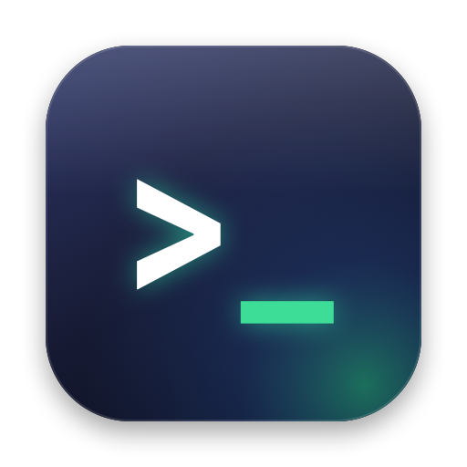
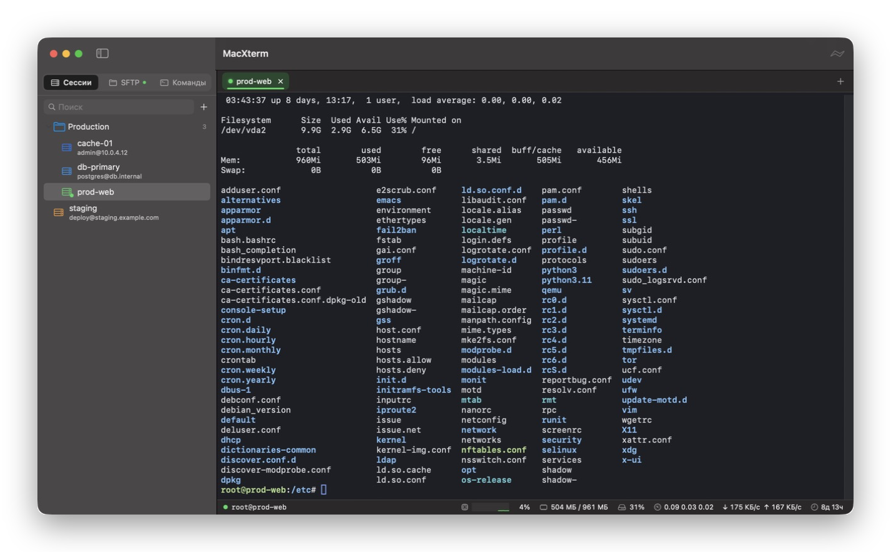
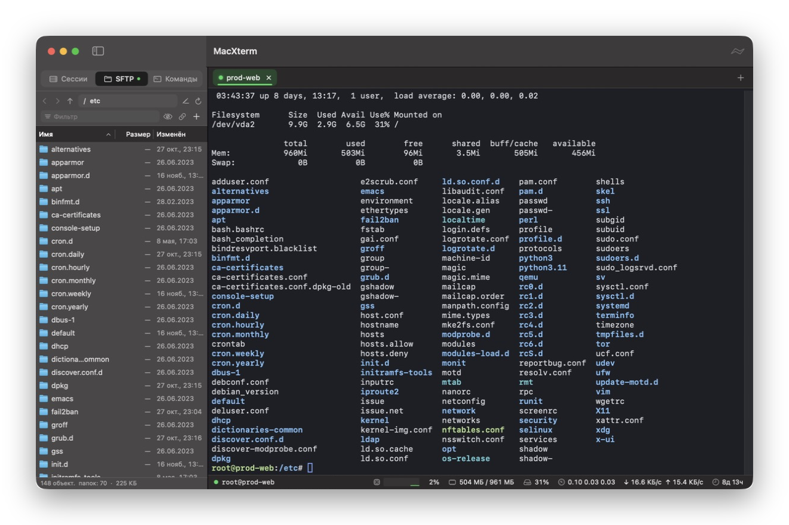

<p align="center">
  
</p>

<h1 align="center">MacXterm</h1>

<p align="center">
  <b>Нативный SSH-клиент для macOS в духе MobaXterm</b><br>
  Терминал, SFTP и монитор сервера в одном окне. Без Electron, без подписок, без лишнего.
</p>

<p align="center">
  <a href="https://github.com/yuj11nn/macxterm/releases/latest"></a>
  
  
  
  <a href="https://github.com/yuj11nn/macxterm/releases"></a>
</p>

<p align="center">
  <a href="https://github.com/yuj11nn/macxterm/releases/latest"><b>⬇︎ Скачать для macOS</b></a>
</p>

<p align="center">
  
</p>

## Возможности

### 🖥 Терминал
- Вкладки с полноценным терминалом: `htop`, `mc`, `vim`, `tmux` выглядят как надо, 256 цветов и truecolor.
- Работает поверх системного `ssh`: ключи, `~/.ssh/config`, ssh-agent и ProxyJump поддерживаются сразу.
- Поиск по выводу (⌘F), сохранение вывода в файл, переименование и дублирование вкладок.
- **Ввод сразу во все вкладки**: одна команда уходит на несколько серверов одновременно.
- Если соединение оборвалось, на экране появляется плашка: нажмите **R**, и вкладка переподключится.
- Три темы оформления, любой моноширинный шрифт, копирование выделением и вставка правой кнопкой (как в MobaXterm).

### 📁 SFTP-панель
- Открывается сама сразу после входа, **без повторного ввода пароля**: использует то же SSH-соединение.
- Работает как Finder: двойной клик, Enter, ⌘↑, сортировка по колонкам, переименование прямо в списке.
- **Drag & drop в обе стороны**: из Finder на сервер и с сервера в Finder. Перетаскивание на папку внутри панели перемещает файлы на сервере.
- **Правка удалённых файлов в любом редакторе**: открываете `nginx.conf` в TextEdit или VS Code, сохраняете, и файл сам заливается обратно.
- Quick Look по пробелу, ⌘C / ⌘V с Finder, очередь передач с прогрессом, права доступа с галочками.
- Режим «Следовать за терминалом»: панель переходит туда же, куда вы сделали `cd`.

### 📊 Монитор сервера
- Строка внизу окна: CPU с графиком, память, диск, load average, скорость сети, аптайм.
- Клик по метрике открывает подробности: топ процессов, разделы дисков и так далее.
- Опрашивается только активная вкладка, остальные стоят на паузе и не нагружают серверы.

### 🔐 Сессии и безопасность
- Сохранённые сессии с папками, цветами и поиском. Двойной клик подключает.
- Пароли и passphrase хранятся **только в связке ключей macOS (Keychain)** и подставляются автоматически.
- Быстрое подключение: ⌘T и строка вида `user@host:port`.

### ⚡️ Команды
- Готовая библиотека из 50+ полезных команд: система, процессы, файлы, сеть, службы и логи, Docker, пакеты.
- Свои сниппеты. Самые частые команды поднимаются наверх.

<p align="center">
  
</p>

## Установка

1. Скачайте `MacXterm-<версия>.dmg` со страницы **[Releases](https://github.com/yuj11nn/macxterm/releases/latest)**.
2. Откройте DMG и перетащите **MacXterm** в папку **Программы**.
3. При первом запуске macOS предупредит, что не может проверить разработчика: приложение пока не подписано платным сертификатом Apple. Разрешите запуск один раз:
   - откройте MacXterm, затем **Системные настройки → Конфиденциальность и безопасность** и внизу нажмите **«Всё равно открыть»**;
   - или выполните в Терминале:
     ```bash
     xattr -dr com.apple.quarantine /Applications/MacXterm.app
     ```
4. При первом подключении с сохранённым паролем macOS спросит доступ к связке ключей. Нажмите **«Разрешать всегда»**.

**Требования:** macOS 14 Sonoma или новее, Mac на Apple Silicon (M1 и новее).

## Горячие клавиши

| Действие | Клавиши |
|---|---|
| Быстрое подключение | ⌘T |
| Новая сессия | ⌘N |
| Закрыть вкладку | ⌘W |
| Переключить вкладку | ⌘1 … ⌘9, ⌘⇧[ / ⌘⇧] |
| Дублировать вкладку | ⌘⇧D |
| Ввод во все вкладки | ⌘⇧I |
| Поиск в терминале | ⌘F, ⌘G / ⌘⇧G |
| Поиск сессии / команды | ⌥⌘F / ⌘⇧P |
| Сессии / SFTP / Команды | ⌃1 / ⌃2 / ⌃3 |
| Очистить терминал | ⌘K |
| Сохранить вывод в файл | ⌘⇧S |
| Переподключить | ⌘⇧R или R на плашке обрыва |
| Размер шрифта | ⌘+ / ⌘− / ⌘0 |
| SFTP: открыть / вверх / удалить | Enter / ⌘↑ / ⌘⌫ |
| SFTP: переименовать / просмотр | F2 / Пробел |

---

<p align="center">
  Сделано на Swift и SwiftUI · терминал на <a href="https://github.com/migueldeicaza/SwiftTerm">SwiftTerm</a>
</p>
